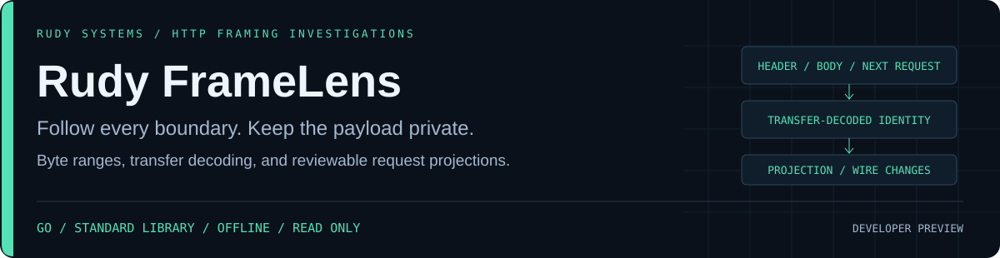

<p align="center"></p>

<p align="center">
<a href="https://github.com/r4venrudy/rudy-framelens/actions/workflows/ci.yml"></a>

<a href="LICENSE"></a>
<a href="https://rudy.systems"></a>
</p>

**A body length, a chunk boundary, or a repeated framing field can change where one HTTP request ends and the next begins. FrameLens makes those byte decisions reviewable offline.**

Rudy FrameLens is a native Go HTTP/1 request-stream investigation and regression tool. It traces request/header/body/chunk boundaries, computes transfer-decoded body identities, stops at the first unsupported or invalid message, and compares a documented request projection across captures. Raw targets, header values, trailer values, chunk extensions and body bytes stay out of reports.

Developer preview · standard library only · streaming payload hashes · exact byte offsets · native Linux, Windows and macOS packages · no network requests or replay.

## What you can investigate

| Question | Evidence |
| --- | --- |
| Where does each request end? | Half-open request ranges, header-end offsets, framing mode and validated-prefix size |
| Does a chunked body reconstruct the same content? | Decoded byte count and SHA-256, each retained chunk's line/data/end offsets, full chunk count and omissions |
| What made parsing stop? | A stable error code, detection offset, static explanation and the complete validated prefix; no later-byte resynchronization |
| Did a gateway or serializer change the message projection? | Positional added/removed/modified requests, wire-only changes and length-delimited projection hashes |
| Does a failed parse pass the comparison gate? | No: comparison becomes unavailable, equality is null and the command returns `2` |
| Can someone review the result locally? | Versioned JSON, text and RUDY HTML with request tables and expandable evidence |

FrameLens applies a **conservative, versioned subset of HTTP/1 request framing**. It does not predict any named proxy/server, validate every HTTP semantic rule, establish endpoint exploitability, or prove request smuggling. Requests must already be reassembled and, if needed, decrypted. See the [profile contract](docs/PROFILE.md).

## Install and run

Download a native package from [Releases](https://github.com/r4venrudy/rudy-framelens/releases), verify `SHA256SUMS.txt`, and extract it. Use `bin/framelens` or `bin\framelens.exe`. The native command requires no language runtime, module downloads, credentials or service account.

```sh
bin/framelens inspect examples/synthetic/pipeline.http
bin/framelens inspect examples/synthetic/pipeline.http --format html --output investigation.html
bin/framelens compare examples/synthetic/fixed.http examples/synthetic/chunked.http --format json --fail-on changed
```

The fixed-length and chunked fixtures carry the same request projection, so the last command reports a wire-only change and returns `0`. A body change reaches the explicit projection-change gate:

```sh
bin/framelens compare examples/synthetic/fixed.http examples/synthetic/changed.http --format json --fail-on changed
```

That command returns `1`. A conflicting or incomplete input returns `2`, even when its already validated prefix contains requests. Packages include seven invented captures, expected byte/digest results and generated HTML/JSON examples. No real user traffic is included.

Reports are new-file-only. Existing reports, source files and their hard-link/symlink aliases are not overwritten. POSIX reports request mode `0600`; Windows uses the destination directory's inherited permissions. An I/O failure can leave a partial newly created report. Use authorized stable copies and review potentially identifying hashes, methods, field names and byte counts before sharing.

## Projection comparison

Alignment is by request ordinal, not a longest-common-subsequence or inferred session identity. A projection contains method, HTTP version, the raw-target hash, normalized header hash, separate trailer hash and transfer-decoded body hash. Header names are lowercased; surrounding SP/HTAB is trimmed; distinct names are sorted while repeated-name order is preserved. Only Content-Length and Transfer-Encoding are excluded from the header projection.

Chunk boundaries/extensions and those two framing fields can change without changing the projection. Content-Encoding, Connection, Trailer declarations, all other field values, actual trailers and the HTTP version remain significant. Percent escapes, URI authority, duplicate-header combination and application semantics are not normalized. Projection equality is not universal HTTP semantic equivalence or evidence that two servers behave identically.

## Conservative profile

- HTTP/1.0 and HTTP/1.1 request lines with strict CRLF, bounded token method, supported URI target form and field syntax. HTTP/1.1 requires one nonempty visible-ASCII Host; repeated Host is rejected. Full authority validation/matching is outside scope.
- No body without framing fields; one decimal Content-Length or one unparameterized chunked transfer coding. TE plus CL, repeated CL (including equal values), CL lists and other transfer-coding chains are rejected.
- Chunk-size integer overflow, extension grammar, data terminators and trailer boundaries are checked. Extensions are never exported. Trailers must be declared and cannot alter framing, routing, authentication or connection-nominated fields under this profile.
- CONNECT, upgrades, HTTP/0.9, HTTP/2, HTTP/3, responses, compressed transfer codings and leading empty-line tolerance are outside the profile. Connection lifecycle and request/response pairing are not modeled.

Some rejected forms are permitted or tolerated by particular standards interpretations or implementations. A rejection is a profile decision, not automatically a vulnerability finding. The framing foundation is [RFC 9112](https://www.rfc-editor.org/rfc/rfc9112.html); explicit restrictions are recorded in the [profile](docs/PROFILE.md).

## Build and test

Use Go 1.27+; all runtime and test imports are from the standard library. Source builds need no package registry. Python 3.9+ standard library is used only for independent fixture/CLI tests and packaging.

```sh
go test ./...
go vet ./...
go build -trimpath -o bin/framelens ./cmd/framelens
python tests/integration.py bin/framelens .
python examples/make_capture.py artifacts/synthetic
```

On Windows, use `bin/framelens.exe` for the build/output and test argument. On a supported CGO-enabled host, run `go test -race ./...`. The bounded fuzz entry point is:

```sh
go test ./framing -run '^$' -fuzz '^FuzzAnalyze$' -fuzztime=20s -parallel=2
```

The Go suite checks supported captures against Go's independent `net/http.ReadRequest` decoder, randomized fixed/chunked body equivalence, fragmented readers, EOF conventions, every byte truncation of representative requests, malformed/profile-restricted traffic and budget edges. The Python oracle checks installed binaries, independent byte offsets/SHA-256 identities, comparison gates, omitted rows/names, Unicode paths, private reports and source preservation. [Validation scope](docs/VALIDATION.md).

## Limits and exit codes

| Resource | Default / maximum |
| --- | --- |
| Input | 256 MiB / 2 GiB with `--max-input-mib` |
| Each decoded body | 64 MiB / 1 GiB with `--max-body-mib`; zero is supported |
| Requests | 2,000 / 10,000 with `--max-messages` |
| Capture-wide chunks, including terminal chunks | 100,000 / 1,000,000 with `--max-chunks` |
| Request line or field line | 8 KiB, including CRLF |
| Request line plus headers | 64 KiB; 256 field lines; 256 bytes per field name |
| Chunk-size/extension line | 4 KiB |
| Trailers | 16 KiB; 64 field lines; at most 64 declared names |
| Retained evidence | 32 data-chunk traces and 32 distinct header/trailer names per request; omissions explicit |
| Display / report | 100 requests/changes by default, up to 1,000 via `--rows`; 16 MiB report ceiling |

`0`: supported analysis completed, requested gate not reached. `1`: comparable inputs differ in projection and `--fail-on changed` was requested. `2`: invalid arguments, input/budget/I/O failure, unsupported/invalid framing, or unavailable comparison. Wire-only differences do not reach the changed gate.

Whole-file SHA-256 is checked before and after parsing. Payloads are streamed and metadata is bounded. These checks do not acquire a live capture or sandbox a hostile filesystem. Empty input is an explicitly empty stream, not evidence that an application received no requests.

## Design and evidence

- [Parser and projection design](docs/DESIGN.md)
- [Versioned strict profile](docs/PROFILE.md)
- [Report contract](docs/REPORTS.md)
- [Validation and preview limits](docs/VALIDATION.md)
- [Synthetic scenario](examples/README.md)
- [Security boundaries](SECURITY.md) · [Contributing](CONTRIBUTING.md)

**RUDY Systems · HTTP framing investigations** · [Project home](https://rudy.systems) · [MIT license](LICENSE)
